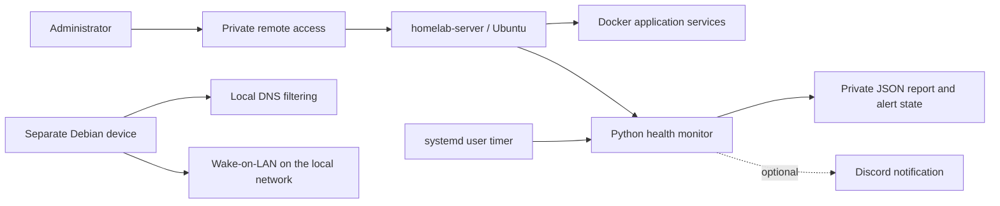

# Server architecture

The private project is a remotely administered Linux homelab. It runs containerized services on an Ubuntu host and uses a separate low-power Debian device for local DNS and Wake-on-LAN. Administration is reached through a private overlay network. Selected application traffic uses an HTTPS reverse proxy.

The example server is called `homelab-server`, its Linux account is `user`, and home paths start with `/home/user/`.

## Responsibilities

The application layer runs services in Docker. The operations layer checks selected container states, HTTP endpoints, TLS certificates, disks and update availability. A systemd timer schedules the monitor. Alerts use a small persistent state machine so a short interruption does not generate a message on every run.

A check must fail three consecutive times before a new alert becomes eligible. Two consecutive successful checks clear an announced problem. Failure to query Docker is reported as an unavailable check, not as proof that every application is down. Notification failures leave events unacknowledged so a later run can retry.

Reports contain configured aliases and selected measurements. They do not contain the inspected container names, URLs, mount paths, raw command output, exception text or webhook value. Choose aliases that are suitable for the notification destination.

## Repository boundary

This copy contains the monitoring implementation, a backup script, example configuration, tests, systemd units and operational documentation. It is not a complete replica of the private machine. DNS, remote access, reverse-proxy services and application databases are described as context, not installed by this repository.

The monitor is configuration-driven. The backup script follows a stop/back-up/restart sequence with an explicit downtime acknowledgment. Configuration, credentials and application data are managed separately from source code.

No external uptime probe is configured here. A successful local check does not establish that a remote client can connect or that every application feature works.
